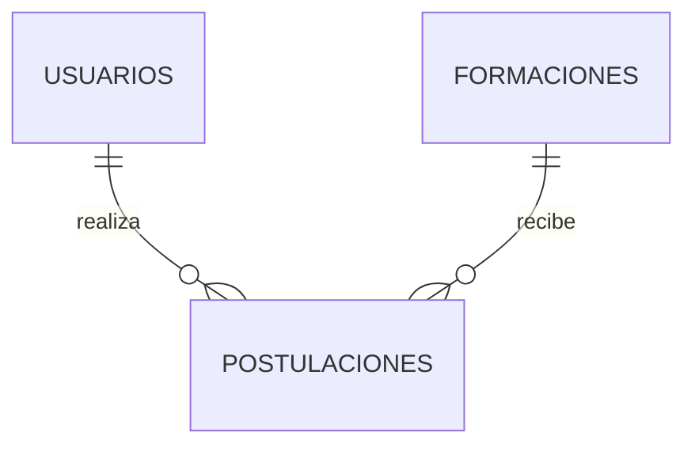

# CompuJoven

Portal web de formaciones para jóvenes. Spring Boot + Thymeleaf + JPA + **MySQL**.

## Requisitos
- Java 21
- Una base de datos MySQL 8 (elige **una** de las dos opciones de abajo)

## Cómo ejecutarlo

**Opción A — Con Docker (recomendada, no hay que instalar MySQL)**
1. Instala **Docker Desktop** y déjalo abierto (ícono de la ballena en la barra).
2. Arranca la app: `.\mvnw spring-boot:run`
   Spring Boot levanta solo el MySQL de `docker-compose.yml` y se conecta a él.
3. Abre http://localhost:8081

**Opción B — Con MySQL instalado en el equipo**
1. Ejecuta una vez, desde la carpeta del proyecto, con el usuario `root`:
   ```
   & "C:\Program Files\MySQL\MySQL Server 8.0\bin\mysql.exe" -u root -p -e "source database/compujoven.sql"
   ```
2. Desactiva Docker para esa sesión y arranca:
   ```
   $env:USE_DOCKER_COMPOSE="false"
   .\mvnw spring-boot:run
   ```

## Datos de ejemplo (siempre disponibles)
En cada arranque la aplicación crea lo que falte, sin duplicar ni pisar lo que ya exista:
5 formaciones, 3 jóvenes con postulaciones y el administrador.

| Rol | Correo | Contraseña |
|---|---|---|
| Administrador | `admin@compujoven.com` | `admin123` |
| Joven | `maria@compujoven.com` | `joven123` |
| Joven | `carlos@compujoven.com` | `joven123` |
| Joven | `laura@compujoven.com` | `joven123` |

Los datos se guardan en MySQL, así que se conservan entre ejecuciones. Con Docker quedan en el
volumen `compujoven-datos` (solo se borran con `docker compose down -v`).

## Si no arranca
| Mensaje | Causa y solución |
|---|---|
| `Communications link failure` | MySQL apagado o puerto distinto. Enciéndelo (`net start MySQL80` como administrador, o `docker compose up -d`). |
| `Access denied for user 'compujoven'` | Falta ejecutar `database/compujoven.sql` con `root`. |
| `'url' attribute is not specified` | Falta o está dañado `src/main/resources/application.properties`; restáuralo del repositorio. |
| `Cannot run program "docker"` / `docker daemon is not running` | Docker Desktop no está instalado o no está abierto. Ábrelo, o usa la Opción B con `USE_DOCKER_COMPOSE=false`. |
| `Port 8081 was already in use` | Otra app usa el puerto. Ciérrala o cambia `server.port`. |

## Historias de usuario cumplidas
| ID | Historia | Dónde está |
|---|---|---|
| RF001 | El joven registra nombre, documento, edad y correo | Pestaña «Registrarse» (`/`) |
| RF002 | Inicio de sesión seguro de joven o administrador | `/login`, contraseñas con BCrypt y rutas protegidas por rol |
| RF003 | El administrador publica formaciones | `/formaciones/nueva`; también puede **editarlas** después (`/formaciones/editar/{id}`) |
| RF004 | El administrador ve información y requisitos de cada formación | `/formaciones` |
| RF005 | El joven ve las formaciones disponibles | `/joven/formaciones`, con barra de búsqueda (texto en nombre, descripción o requisitos) y filtro «Solo abiertas» |
| RF006 | El joven consulta sus datos registrados | `/joven/perfil` («Mi perfil»): ver y editar datos, subir hoja de vida (.pdf / .docx, máx. 5 MB) y eliminar la cuenta |
| RF007 | El administrador controla el estado según la capacidad | Botón abrir/cerrar; se cierra sola al llenarse los cupos. El administrador también **acepta o rechaza** a cada postulado y el joven ve el resultado en «Mi perfil» y en la lista de formaciones (las rechazadas liberan el cupo) |
| RF008 | Uso desde el celular | Diseño adaptable (las tablas se vuelven tarjetas en pantallas pequeñas) |

## Modelo

Tablas: `usuarios`, `formaciones` (con `requisitos` y `capacidad`), `postulaciones` (única por usuario + formación) y `hojas_de_vida` (un archivo por usuario).
